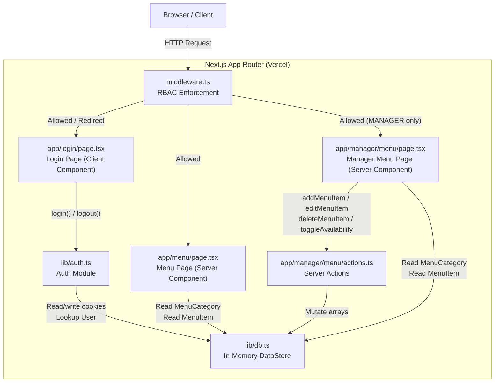
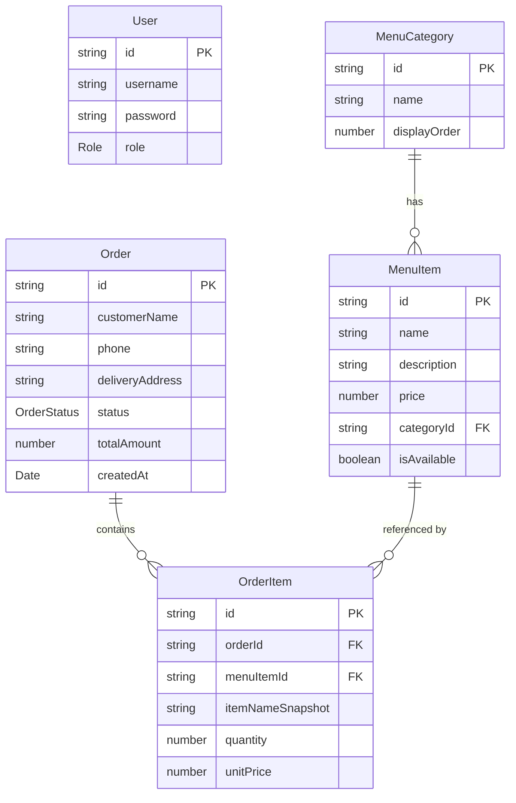

# Design Document: Food Ordering Milestone 1

## Overview

Milestone 1 establishes the foundational infrastructure of the SmartX Food Ordering Web Application. The system is a Next.js 14 App Router application written in strict TypeScript, hosted on Vercel. It delivers five core capabilities:

1. **In-memory data store** — a single module (`/lib/db.ts`) that owns all runtime state.
2. **Cookie-based authentication** — a lightweight auth module (`/lib/auth.ts`) with no JWT or encryption.
3. **Role-based access control** — Next.js middleware that guards `/staff/*` and `/manager/*` routes.
4. **Public menu page** — a server-rendered, unauthenticated menu display.
5. **Manager menu administration** — a protected page backed by Next.js Server Actions for CRUD operations on menu items.

There is no external database, no online payment of any kind, and no third-party auth service. All data lives in module-level JavaScript arrays for the lifetime of the server process.

### Key Design Decisions

- **In-memory only**: simplifies Milestone 1 by eliminating DB setup. The DataStore is a single module with exported mutable arrays; all other modules import from it directly.
- **Cookie-based auth**: `user_id` and `user_role` are stored in a plain Next.js cookie. No encryption is needed because the app has no real attack surface in this milestone.
- **No `<form>` elements**: all submissions use controlled inputs + `onClick` handlers, as required by the project constraints.
- **TypeScript strict mode throughout**: `any` is banned; all types are explicitly defined.

---

## Architecture



### Request Flow

1. Every request passes through `middleware.ts` first.
2. Public routes (`/`, `/menu`, `/cart`, `/checkout`, `/checkout/confirmation`) are forwarded unchanged.
3. `/staff/*` requests are checked for a valid session with role `STAFF` or `MANAGER`; otherwise redirected to `/login`.
4. `/manager/*` requests are checked for a valid session with role `MANAGER`; otherwise redirected to `/login`.
5. All other paths are forwarded unchanged.

---

## Components and Interfaces

### `/lib/db.ts` — In-Memory DataStore

Exports mutable arrays and their associated TypeScript types. This is the single source of truth for all runtime data.

```typescript
// Exported types
export type Role = "STAFF" | "MANAGER";
export type OrderStatus = "PENDING" | "ACTIVE" | "COMPLETED";

export interface User {
  id: string;
  username: string;
  password: string; // plaintext
  role: Role;
}

export interface MenuCategory {
  id: string;
  name: string;
  displayOrder: number;
}

export interface MenuItem {
  id: string;
  name: string;
  description: string;
  price: number;       // > 0
  categoryId: string;  // references MenuCategory.id
  isAvailable: boolean;
}

export interface Order {
  id: string;
  customerName: string;
  phone: string;
  deliveryAddress: string;
  status: OrderStatus;
  totalAmount: number;
  createdAt: Date;
}

export interface OrderItem {
  id: string;
  orderId: string;
  menuItemId: string;
  itemNameSnapshot: string;
  quantity: number;  // integer ≥ 1
  unitPrice: number; // > 0
}

// Exported mutable arrays
export const users: User[] = [ /* seed data */ ];
export const menuCategories: MenuCategory[] = [ /* seed data */ ];
export const menuItems: MenuItem[] = [ /* seed data */ ];
export const orders: Order[] = [];
export const orderItems: OrderItem[] = [];
```

Seed data requirements:
- ≥ 2 `User` records: one `STAFF`, one `MANAGER`
- ≥ 2 `MenuCategory` records
- ≥ 4 `MenuItem` records, at least one per category
- Empty `orders` and `orderItems` arrays

### `/lib/auth.ts` — Authentication Module

```typescript
// login: returns User on success, null on failure
export async function login(username: string, password: string): Promise<User | null>

// getCurrentUser: returns the User matching the session cookie, or null
export async function getCurrentUser(): Promise<User | null>

// logout: clears the session cookie
export async function logout(): Promise<void>
```

Internal logic:
- `login` trims nothing — exact match required.
- Returns `null` immediately if `username === ""` or `password === ""`.
- On success, sets two cookies: `user_id` (User.id) and `user_role` (User.role) via `cookies()` from `next/headers`.
- `getCurrentUser` reads `user_id` cookie, looks up in `users` array, returns match or `null`.
- `logout` deletes both cookies.

### `/middleware.ts` — RBAC Middleware

```typescript
// Signature required by Next.js
export function middleware(request: NextRequest): NextResponse

export const config = {
  matcher: ["/staff/:path*", "/manager/:path*"],
};
```

Logic:
- Reads `user_id` and `user_role` cookies from `request.cookies`.
- Validates that `user_id` resolves to a `User` in the `users` array.
- For `/staff/*`: allows `STAFF` or `MANAGER`.
- For `/manager/*`: allows only `MANAGER`.
- Any other case: `NextResponse.redirect(new URL("/login", request.url))`.
- Public routes are not in the `matcher` so they are never intercepted.

### `/app/login/page.tsx` — Login Page

Client Component (`"use client"`). Uses `useState` for:
- `username: string`
- `password: string`
- `error: string | null`
- `loading: boolean`

Submit handler (bound to `onClick`):
1. Sets `loading = true`, clears `error`.
2. Calls `login(username, password)`.
3. On success: redirects via `useRouter().push()` to `/staff/orders` (STAFF) or `/manager/sales` (MANAGER).
4. On `null`: sets `error = "Invalid credentials"`.
5. On exception: sets `error = "Something went wrong. Please try again."`.
6. Always sets `loading = false`.

Submit button: `disabled={loading}`.

### `/app/menu/page.tsx` — Public Menu Page

Server Component (no `"use client"`). Reads directly from `menuCategories` and `menuItems` at render time. Groups items by category, sorts by `displayOrder`. Formats price as `$X.XX`. Marks unavailable items with `disabled` button and `aria-disabled="true"`.

### `/app/manager/menu/page.tsx` — Manager Menu Page

Server Component guarded by Middleware. Reads `menuItems` and `menuCategories` from DataStore. Displays a form-free admin UI (controlled inputs in a Client Component island for the add/edit forms). Invokes Server Actions directly.

### `/app/manager/menu/actions.ts` — Server Actions

```typescript
"use server";

export type ActionResult = { success: true } | { success: false; error: string };

export async function addMenuItem(data: {
  name: string;
  description: string;
  price: number;
  categoryId: string;
}): Promise<ActionResult>

export async function editMenuItem(data: {
  id: string;
  name?: string;
  description?: string;
  price?: number;
  categoryId?: string;
}): Promise<ActionResult>

export async function deleteMenuItem(id: string): Promise<ActionResult>

export async function toggleAvailability(id: string): Promise<ActionResult>
```

All actions operate directly on the `menuItems` array imported from `/lib/db.ts`. ID generation uses `crypto.randomUUID()`.

---

## Data Models

### Entity Relationship



### Type Constraints (enforced in code, not DB)

| Field | Constraint |
|---|---|
| `MenuItem.price` | `> 0` and `≤ 9999.99` (for `addMenuItem`) |
| `MenuItem.name` | non-empty, `≤ 100` characters |
| `MenuItem.description` | `≤ 500` characters |
| `OrderItem.quantity` | integer `≥ 1` |
| `OrderItem.unitPrice` | `> 0` |
| `User.role` | `"STAFF" \| "MANAGER"` |
| `Order.status` | `"PENDING" \| "ACTIVE" \| "COMPLETED"` |

### Seed Data Shape

```typescript
// Minimum seed — actual values can differ
users: [
  { id: "u1", username: "staff1", password: "pass123", role: "STAFF" },
  { id: "u2", username: "manager1", password: "pass123", role: "MANAGER" },
]

menuCategories: [
  { id: "c1", name: "Starters", displayOrder: 1 },
  { id: "c2", name: "Mains", displayOrder: 2 },
]

menuItems: [
  { id: "m1", name: "Spring Rolls", description: "Crispy veg rolls", price: 5.99, categoryId: "c1", isAvailable: true },
  { id: "m2", name: "Garlic Bread",  description: "Toasted with butter", price: 3.99, categoryId: "c1", isAvailable: true },
  { id: "m3", name: "Chicken Curry", description: "Mild curry with rice", price: 12.99, categoryId: "c2", isAvailable: true },
  { id: "m4", name: "Veggie Burger", description: "Plant-based patty", price: 10.99, categoryId: "c2", isAvailable: false },
]
```

---

## Correctness Properties

*A property is a characteristic or behavior that should hold true across all valid executions of a system — essentially, a formal statement about what the system should do. Properties serve as the bridge between human-readable specifications and machine-verifiable correctness guarantees.*

### Property 1: Login with valid credentials returns the matching user

*For any* username and password pair that exactly matches a record in the `users` array, calling `login(username, password)` SHALL return the `User` object whose `id`, `username`, and `role` match the stored record.

**Validates: Requirements 2.1, 2.2**

---

### Property 2: Login with non-matching or empty credentials returns null

*For any* call to `login` where either field is an empty string, or where no record in the `users` array has both `username` and `password` matching the supplied values, `login` SHALL return `null` and SHALL NOT establish a session.

This single property subsumes the "invalid credentials" case (2.3) and the "empty string short-circuit" case (2.4) — both produce `null` with no side-effects, so they are tested together by generating inputs from both populations.

**Validates: Requirements 2.3, 2.4**

---

### Property 3: Session round-trip — login then getCurrentUser returns the same user

*For any* valid `User` in the `users` array, after a successful `login(user.username, user.password)`, a subsequent call to `getCurrentUser()` SHALL return a `User` object whose `id` equals the logged-in user's `id`.

**Validates: Requirements 2.2, 2.5**

---

### Property 4: Logout invalidates the session

*For any* user that has been successfully logged in, calling `logout()` SHALL cause the next call to `getCurrentUser()` to return `null`.

**Validates: Requirements 2.7**

---

### Property 5: addMenuItem with valid inputs appends a correctly shaped record

*For any* valid set of `addMenuItem` inputs (`name` non-empty and ≤ 100 chars, `description` ≤ 500 chars, `price` in [0.01, 9999.99], `categoryId` referencing an existing `MenuCategory`), after the action completes the `menuItems` array SHALL contain exactly one additional record whose `name`, `description`, `price`, and `categoryId` equal the supplied inputs, whose `isAvailable` is `true`, and whose `id` is a non-empty unique string not previously present in the array.

**Validates: Requirements 6.3**

---

### Property 6: addMenuItem with invalid inputs does not mutate the DataStore

*For any* call to `addMenuItem` where `name` is empty, `price` is outside [0.01, 9999.99], `description` exceeds 500 characters, or `categoryId` is empty or does not reference an existing `MenuCategory`, the `menuItems` array SHALL remain unchanged (same length and same records) and the action SHALL return `{ success: false }`.

**Validates: Requirements 6.12**

---

### Property 7: editMenuItem updates only the supplied fields

*For any* existing `MenuItem` id and any non-empty subset of `{name, description, price, categoryId}`, calling `editMenuItem` with that id and subset SHALL update exactly those fields on the matching record and leave all other fields of that record (including `isAvailable` and `id`) unchanged.

**Validates: Requirements 6.4**

---

### Property 8: Mutations with an unknown MenuItem id are no-ops

*For any* string `id` that does not match any record in the `menuItems` array, calling `editMenuItem({id, ...})`, `deleteMenuItem(id)`, or `toggleAvailability(id)` SHALL leave the `menuItems` array with the same length and the same records as before the call.

This consolidates the three separate "unknown id" edge cases (6.5, 6.7, 6.9) into a single property because the expected post-condition is identical for all three: the array is unmodified.

**Validates: Requirements 6.5, 6.7, 6.9**

---

### Property 9: toggleAvailability is an involution (round-trip restores original state)

*For any* existing `MenuItem`, calling `toggleAvailability(item.id)` SHALL flip `isAvailable` to `!item.isAvailable` while leaving all other fields unchanged. Calling `toggleAvailability` a second time on the same id SHALL restore `isAvailable` to its original value, confirming the operation is its own inverse.

**Validates: Requirements 6.8**

---

### Property 10: Menu page renders item availability state correctly

*For any* state of the `menuItems` array, every item with `isAvailable = true` SHALL be rendered with an enabled "Add to Cart" button (no `disabled` attribute), and every item with `isAvailable = false` SHALL be rendered with a `disabled` button and `aria-disabled="true"`.

**Validates: Requirements 5.4, 5.5**

---

### Property 11: Menu items are grouped and sorted by category displayOrder

*For any* state of `menuCategories` and `menuItems`, the rendered menu SHALL present category sections in strictly ascending `displayOrder` order, and each `MenuItem` SHALL appear only within the section corresponding to its `categoryId`.

**Validates: Requirements 5.2**

---

## Error Handling

### Authentication Errors

| Scenario | Behavior |
|---|---|
| Empty username or password | `login` returns `null` immediately |
| No matching user in DataStore | `login` returns `null` |
| Unexpected exception in `login` | LoginPage catches, sets error message, does not propagate |
| No active session | `getCurrentUser` returns `null` |
| Stale `user_id` cookie (user removed from DataStore) | `getCurrentUser` returns `null` |

### Middleware Errors

| Scenario | Behavior |
|---|---|
| Missing session cookies on `/staff/*` | Redirect to `/login` |
| Missing session cookies on `/manager/*` | Redirect to `/login` |
| `user_id` resolves to no User | Redirect to `/login` |
| `STAFF` user accesses `/manager/*` | Redirect to `/login` |
| Any path not in matcher | Allowed through without checks |

### Server Action Errors

| Scenario | Behavior |
|---|---|
| `addMenuItem` with empty name | Returns `{ success: false, error: "..." }` |
| `addMenuItem` with price out of range | Returns `{ success: false, error: "..." }` |
| `addMenuItem` with unknown categoryId | Returns `{ success: false, error: "..." }` |
| `editMenuItem` with unknown id | Returns `{ success: true }` (no-op, DataStore unchanged) |
| `deleteMenuItem` with unknown id | Returns `{ success: true }` (no-op, DataStore unchanged) |
| `toggleAvailability` with unknown id | Returns `{ success: true }` (no-op, DataStore unchanged) |

> Note: `editMenuItem`, `deleteMenuItem`, and `toggleAvailability` return `success: true` on unknown id because the desired post-condition (item does not exist / is unchanged) is already satisfied.

### Login Page Error States

| Scenario | UI Behavior |
|---|---|
| Pre-submission | No error shown |
| `login` returns `null` | Inline error: "Invalid credentials" |
| `login` throws | Inline error: "Something went wrong. Please try again." |
| While `login` is pending | Submit button disabled |

---

## Testing Strategy

### Overview

This milestone uses a **dual testing approach**: example-based unit tests for specific behaviors and property-based tests for universal correctness properties. The property-based testing library for TypeScript is [**fast-check**](https://fast-check.dev/), which integrates with Vitest.

PBT is applicable here because the DataStore mutations, auth logic, and menu rendering functions are pure or near-pure functions whose behavior varies meaningfully with input, and running 100+ iterations with randomly generated inputs will surface edge cases that hand-written examples would miss.

### Unit Tests (Example-Based)

**`/lib/db.ts`**
- Seed data structure: verify ≥ 2 users, ≥ 2 categories, ≥ 4 items, one STAFF, one MANAGER.
- Type shapes: all required fields present on every record.

**`/lib/auth.ts`**
- `login("staff1", "pass123")` returns the matching User.
- `login("staff1", "wrong")` returns `null`.
- `login("", "pass123")` returns `null` without touching DataStore.
- `getCurrentUser()` returns `null` when no cookie is set.
- `logout()` followed by `getCurrentUser()` returns `null`.

**`/middleware.ts`**
- Request to `/staff/orders` with valid STAFF session → allowed.
- Request to `/manager/menu` with valid MANAGER session → allowed.
- Request to `/manager/menu` with STAFF session → redirect `/login`.
- Request to `/menu` → allowed (not in matcher).

**`/app/login/page.tsx`**
- Error not shown before submission.
- Submit button disabled during loading.
- Error shown when `login` returns `null`.
- Error shown when `login` throws.

**`/app/manager/menu/actions.ts`**
- `deleteMenuItem` with a known id removes exactly that item.
- `editMenuItem` with a known id updates the named fields only.

### Property-Based Tests (fast-check, minimum 100 iterations each)

Each property test is tagged with a comment in the format:
`// Feature: food-ordering-milestone-1, Property N: <property_text>`

| Property | Test Description |
|---|---|
| **P1** Login valid credentials | Generate (username, password) pairs that match a record in the `users` array; assert `login` returns that `User`. |
| **P2** Login null for non-matching or empty inputs | Generate pairs where at least one field is `""` or no record matches; assert `login` returns `null` with no session cookie set. |
| **P3** Session round-trip | For any seeded `User`, login then `getCurrentUser`; assert returned `id` matches. |
| **P4** Logout invalidates session | For any seeded `User`, login then logout then `getCurrentUser`; assert `null`. |
| **P5** `addMenuItem` appends correctly | Generate valid (name ≤ 100, desc ≤ 500, price ∈ [0.01, 9999.99], existing categoryId); assert array grows by 1 with correct fields and `isAvailable = true`. |
| **P6** `addMenuItem` invalid inputs no-op | Generate inputs violating any constraint; assert array unchanged and `success = false`. |
| **P7** `editMenuItem` updates only supplied fields | Generate an existing item id and a random non-empty subset of fields; assert only those fields change, others preserved. |
| **P8** Unknown id mutations are no-ops | Generate strings not matching any `MenuItem` id; assert array unchanged for `editMenuItem`, `deleteMenuItem`, and `toggleAvailability`. |
| **P9** `toggleAvailability` involution | For any existing item, call `toggleAvailability` twice; assert `isAvailable` is restored to its original value. |
| **P10** Menu renders availability correctly | Generate arbitrary `menuItems` arrays; for each item assert `isAvailable` determines enabled/disabled button state and `aria-disabled` attribute. |
| **P11** Menu category ordering | Generate arbitrary `menuCategories` with shuffled `displayOrder`; assert rendered category sections appear in strictly ascending `displayOrder` order. |

### Integration Tests

- Full login → redirect flow (STAFF → `/staff/orders`, MANAGER → `/manager/sales`).
- Middleware: end-to-end request with cookie → allowed / redirected.
- `addMenuItem` → `menuItems` array persists within the same process (no DB flush needed).

### What Is Not Tested

- UI aesthetics and layout.
- TypeScript compilation (enforced by `tsc --noEmit` in CI, not unit tests).
- Online payment (none exists — this is verified by absence via `grep`/static analysis in CI).
